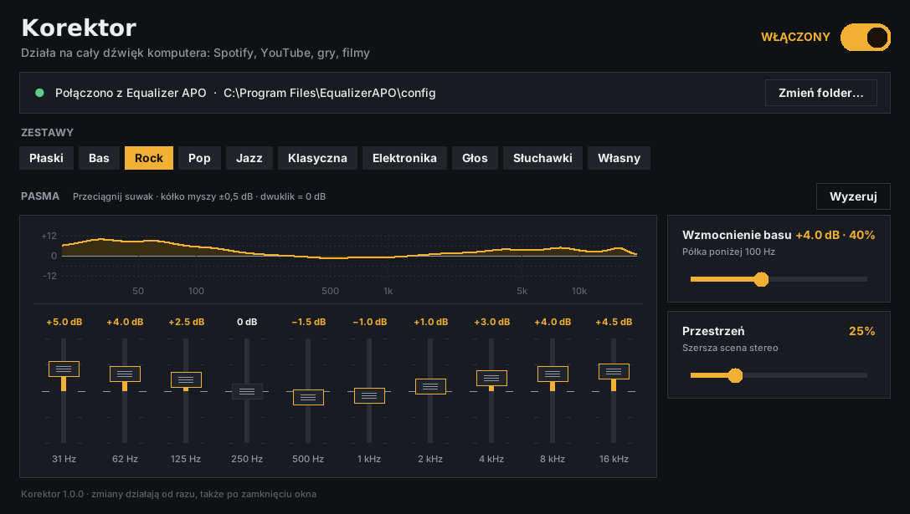

# Korektor PC

Globalny korektor dźwięku dla Windows 10/11: stroi **cały** dźwięk komputera
(Spotify, YouTube w przeglądarce, gry, filmy), tak jak „Korektor” z `eq-app/` stroi telefon.



## Co potrafi

- **10 pasm** (31 Hz – 16 kHz, ±12 dB): przeciąganie myszą, kółko myszy ±0,5 dB, dwuklik zeruje pasmo.
- **Zestawy:** Płaski, Bas, Rock, Pop, Jazz, Klasyczna, Elektronika, Głos, Słuchawki. Gdy przesuniesz suwak, włącza się „Własny”.
- **Wzmocnienie basu** (półka poniżej 100 Hz, do +10 dB) i **Przestrzeń** (szersza scena stereo).
- **Wykres charakterystyki** pokazuje, jak dźwięk naprawdę się zmienia.
- **Bez przesterowań:** program sam dobiera ujemny przedwzmacniacz, więc przy podbiciach jest nieco ciszej.
  Podgłoś wtedy zwykłą głośnością systemu.
- **Działa po zamknięciu okna:** nie trzeba zostawiać programu w tle.

## Jak to działa

Windows nie pozwala zwykłemu programowi zmieniać dźwięku innych aplikacji. Robi to darmowy sterownik
[Equalizer APO](https://sourceforge.net/projects/equalizerapo/) (open source). Korektor jest jego wygodnym panelem:

1. Zapisuje filtry do `korektor.txt` w folderze `config` Equalizer APO (zwykle `C:\Program Files\EqualizerAPO\config`).
2. Dopisuje na końcu `config.txt` jedną linię `Include: korektor.txt`. Przy pierwszej zmianie robi kopię `config.txt.korektor-kopia`.
3. Equalizer APO wczytuje zmienione pliki od razu.

Wyłączenie przełącznikiem zostawia pusty `korektor.txt`, więc dźwięk wraca do oryginału.
Polecenie `Korektor.exe --odlacz` usuwa linię `Include` i plik `korektor.txt`.

## Instalacja na PC

1. Zainstaluj **Equalizer APO**. W oknie „Configurator” zaznacz urządzenie, którego słuchasz
   (głośniki, słuchawki, HDMI). Uruchom komputer ponownie.
2. Pobierz **Korektor.exe**: zakładka **Actions** w repozytorium → „Windows – Korektor PC” → ostatnie
   uruchomienie → **Artifacts** → `Korektor-Windows` (zip z plikiem .exe). Rozpakuj i uruchom.
   - Windows SmartScreen może ostrzec o nieznanym wydawcy (plik nie ma płatnego podpisu):
     „Więcej informacji” → „Uruchom mimo to”.
3. Włącz korektor przełącznikiem w prawym górnym rogu.

Bez .exe: zainstaluj Pythona 3.10+ z python.org i kliknij dwukrotnie `uruchom.bat` (albo `pyw -3 -m korektor`).
Program nie ma zależności poza biblioteką standardową.

Gdy przy zapisie pojawi się „Brak uprawnień”, kliknij **Uruchom jako administrator**. Zdarza się to, gdy
folder `config` nie jest zapisywalny dla zwykłego konta. Ustawienia programu są w `%APPDATA%\Korektor\ustawienia.json`.

## Rozwój

```bash
cd korektor-pc
python -m pytest -q tests                 # logika, zapis plików, okno (gdy jest ekran)
python -m korektor                        # uruchomienie
KOREKTOR_APO_DIR=/tmp/apo python -m korektor   # test bez Equalizer APO: folder z dowolnym config.txt
```

- `korektor/eq.py`: pasma, zestawy, charakterystyka (biquady RBJ), tekst konfiguracji Equalizer APO.
- `korektor/apo.py`: wyszukiwanie folderu (rejestr, Program Files), atomowy zapis, linia `Include`.
- `korektor/app.py`: okno tkinter (fadery, wykres, przełącznik).
- `.github/workflows/korektor-pc.yml`: testy na Windows, `Korektor.exe` przez PyInstaller, test gotowego pliku.
