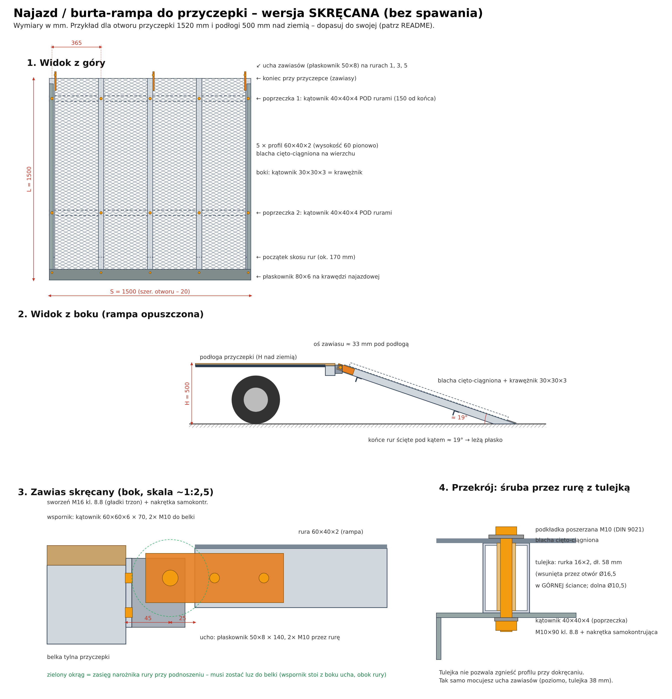

# Najazd / burta-rampa do przyczepki – wersja skręcana (bez spawania)

To kopia rampy z filmiku: tylna burta przyczepki, która po opuszczeniu robi za najazd dla kosiarki.
W oryginale jest kratka (blacha cięto-ciągniona) na spawanej ramie. Tu cała rama jest skręcana
śrubami. Do budowy wystarczą **szlifierka kątowa, wiertarka i klucze**.

Rysunek wektorowy: [`rysunek.svg`](rysunek.svg)

**Podgląd 3D** z każdym otworem i każdą śrubą: [`podglad-3d.html`](podglad-3d.html)
(otwórz w przeglądarce; obracanie palcem, suwak „Rozłóż”, „Prześwietl”, dotknięcie części pokazuje jej otwory i śruby).

**Symulacja wjazdu motocykla (Fat Boy):** [`symulacja-fat-boy.html`](symulacja-fat-boy.html). Wersja 3D: [`symulacja-3d.html`](symulacja-3d.html)
(widok z boku, zza motocykla i od dołu na krawędź, przycisk „Najgorszy moment”). Pokazuje, czy spód motocykla
zahaczy o rampę lub krawędź przyczepki przy danej wysokości podłogi i długości najazdu.
Wynik dla tej rampy (1,5 m, podłoga 500 mm): **zahacza** o krawędź przyczepki. Prosty najazd musi mieć ok. **3,2 m**,
łukowy (wygięty o ~7 cm) wystarczy **2,5 m**.

---

## 1. Najpierw zmierz swoją przyczepkę

| Co mierzysz | Po co |
|---|---|
| **Szerokość otworu z tyłu** (między słupkami/burtami) | szerokość rampy **S = otwór − 20 mm** |
| **Wysokość podłogi nad ziemią H** | długość rampy i kąt ścięcia rur |
| **Belka tylna**: kształt (ceownik, profil zamknięty, kątownik) i wysokość | do niej przykręcasz wsporniki zawiasów |
| Czy przyczepka ma **opuszczaną tylną burtę na zawiasach** | jeśli tak, możesz zostawić jej zawiasy (pkt 6B) |

**Długość rampy L.** Im dłuższa, tym łagodniej się wjeżdża:

| H (podłoga) | L = 1200 | L = 1500 | L = 1800 |
|---|---|---|---|
| 400 mm | 19° | 15° | 13° |
| 500 mm | 24° | **19°** | 16° |
| 600 mm | 30° | 23° | 19° |

Wzór: kąt ≈ asin(H / L). Kosiarki z nisko zawieszonym koszem zawadzają przy ~20° i więcej.
**Sprawdź w instrukcji kosiarki**, jaki kąt jest dopuszczalny i czy na rampę wjeżdża się przodem, czy tyłem.

Wszystkie wymiary poniżej są dla przykładu **S = 1500, L = 1500, H = 500**.

---

## 2. Lista materiałów

### Stal (najlepiej ocynk; czarną stal pomaluj po wierceniu)

| Poz. | Element | Profil | Ilość × długość |
|---|---|---|---|
| 1 | Podłużnice (nośne) | profil zamknięty **60×40×2** | 5 × 1500 |
| 2 | Poprzeczki (pod rurami) | kątownik **40×40×4** | 2 × 1500 |
| 3 | Krawężniki boczne | kątownik **30×30×3** | 2 × 1380 |
| 4 | Listwa krawędzi najazdowej | płaskownik **80×6** | 1 × 1500 |
| 5 | Ucha zawiasów (na rampie) | płaskownik **50×8** | 3 × 140 |
| 6 | Wsporniki zawiasów (na przyczepce) | kątownik **60×60×6** | 3 × 70 |
| 7 | Tulejki dystansowe | rurka stalowa **16×2** (np. hydrauliczna) | 10 × 58 mm + 6 × 38 mm |
| 8 | Pokrycie | **blacha cięto-ciągniona** ocynk, oczko ok. 60×25, mostek i grubość 3–4 mm (np. 62×25×4×4; lżejsza 43×13×3×3) | 1500 × 1500 |

Arkusz blachy ma zwykle 1000×2000 albo 1250×2500. Jeśli potrzebujesz dwóch kawałków,
**łączenie musi wypaść na rurze**.

### Śruby (klasa **8.8**, ocynk, nakrętki **samokontrujące** z nylonem)

| Gdzie | Śruba | Szt. |
|---|---|---|
| Poprzeczki do rur (pionowo, przez całą rurę) | M10×90 + podkładka poszerzana DIN 9021 od góry + zwykła od dołu | 10 |
| Ucha do rur (poziomo, przez rurę) | M10×70 + 2 podkładki | 6 |
| Sworznie zawiasów | **M16×50 z gładkim trzonem** (DIN 931, gwint tylko na końcu) + 3 podkładki | 3 |
| Wsporniki do belki przyczepki | M10, długość pod Twoją belkę (albo nitonakrętki M10 przy profilu zamkniętym) | 6 |
| Listwa najazdowa | M8×25 + 2 podkładki | 5 |
| Krawężniki do rur 1 i 5 | wkręty samowiercące 5,5×38 do grubej stali, co ~200 mm | ~16 |
| Blacha do rur 2, 3, 4 | wkręty samowiercące 5,5×25 + podkładka poszerzana M6, co ~150 mm | ~30 |
| Blokada w pozycji pionowej | 2 łańcuchy z hakiem/karabińczykiem **albo** 2 przykręcane zamki burtowe | 2 |

### Narzędzia
Szlifierka kątowa + tarcze do cięcia, wiertarka (najlepiej na statywie) i wiertła HSS 4, 8,5, 10,5, 16,5, 17,
klucze 13/17/24, ściski stolarskie, miara, kątownik, marker, smar, farba lub cynk w sprayu.

**Waga rampy:** ok. 55–60 kg. To więcej niż spawany oryginał, bo śruby wymagają grubszych elementów.
Do podnoszenia trzeba dźwignąć ok. 30 kg na końcu rampy.

---

## 3. Dlaczego nic się nie wygnie

- Pod kołem kosiarki (≈ 450 kg z operatorem, na jedno koło napędowe przyjąłem 250 kg z zapasem
  na szarpnięcia) jedna rura 60×40×2 na rozpiętości 1,5 m pracuje przy ~115 MPa. Stal S235
  ustępuje dopiero przy 235 MPa. W praktyce koło opiera się zwykle na dwóch rurach naraz.
- Rozstaw rur to 365 mm. Na takim odcinku blacha 3–4 mm przenosi koło bez zapadania.
  **Kierunek blachy:** dłuższa przekątna oczek (LWD) ma iść **w poprzek rampy**, prostopadle do rur.
  W tym kierunku blacha jest sztywniejsza.
- **Tulejki dystansowe** w rurach są obowiązkowe. Bez nich śruba zgniata profil przy dokręcaniu
  i całość zaczyna się luzować (przekrój 4 na rysunku).

---

## 4. Cięcie

1. **5 rur 60×40×2** utnij na L = 1500.
2. **Ścięcie końców najazdowych.** Na końcu, który leży na ziemi, zetnij **dolną część** każdej rury
   pod kątem rampy (≈ 19° przy H = 500). Górna ścianka zostaje pełnej długości, dolna kończy się
   **~175 mm** wcześniej (wzór: 60 / tan(kąt)). Dzięki temu rampa leży płasko na ziemi bez progu.
   Wszystkie 5 rur tnij razem, ściśnięte, żeby skos wyszedł jednakowy.
3. Kątowniki, płaskowniki i tulejki utnij na wymiar z tabeli. Krawędzie stępić pilnikiem.

## 5. Składanie ramy

1. Ułóż rury na płaskim podłożu **wysokością 60 pionowo**, w osiach co 365 mm
   (pozycje osi od lewej krawędzi: 20, 385, 750, 1115, 1480). Sprawdź przekątne, mają być równe.
2. **Poprzeczki** (kątownik 40×40×4) połóż **pod rurami**: pierwszą 150 mm od końca zawiasowego,
   drugą ~1000 mm od niego (przed początkiem skosu). Pozioma półka przylega do rur, pionowa idzie w dół.
3. W każdym skrzyżowaniu rura/poprzeczka:
   - **w dolnej ściance rury i w kątowniku** otwór **Ø10,5**,
   - **w górnej ściance rury** otwór **Ø16,5**,
   - przez górny otwór wsuń **tulejkę 58 mm**, ma oprzeć się o dolną ściankę,
   - śrubę M10×90 włóż **od góry** (później, razem z blachą), nakrętkę daj od dołu.
4. Na razie skręć luźno. Dokręcisz po założeniu blachy.

## 6. Zawiasy (bez spawania)

### 6A. Zawiasy skręcane, wersja podstawowa (rysunek, detal 3)

Trzy zawiasy: na **rurze 1, 3 i 5**. Każdy to **ucho** na rampie, **wspornik** na przyczepce i **sworzeń M16**.

1. **Ucho**: płaskownik 50×8 × 140 mm. Otwory licząc od tylnego końca: **Ø10,5 na 20 i 70 mm**,
   **Ø17 na 115 mm** (sworzeń), środkiem wysokości.
   Przyłóż ucho do **boku rury** (przy rurach skrajnych od wewnętrznej strony, żeby rampa nie była
   szersza), tak żeby wystawało **50 mm za koniec rury**. Otwór sworznia ma być wtedy 25 mm za rurą,
   na środku jej wysokości. Przez rurę wierć Ø10,5, w przeciwnej ściance Ø16,5 na tulejkę 38 mm.
   Przykręć 2× M10×70.
2. **Wspornik**: kątownik 60×60×6 × 70 mm. Jedna półka przykręcona do **tylnej belki przyczepki**
   (2× M10 jeden nad drugim, rozstaw 35 mm), druga sterczy do tyłu i ma otwór **Ø17 w odległości 45 mm od belki**,
   20 mm poniżej górnej krawędzi wspornika (wspornik nie wystaje ponad podłogę).
   Wspornik stoi **obok ucha, po stronie dalszej od rury** (połączenie jednocięte: ucho + wspornik + sworzeń).
3. **Wysokość:** oś sworznia ok. **33 mm poniżej górnej powierzchni podłogi**. Wtedy opuszczona
   rampa (blacha na rurach) wypada równo z podłogą.
4. **Jak trafić w jedną oś (najważniejsze):** przykręć najpierw ucha do rampy. Przełóż przez wszystkie
   3 ucha i 3 wsporniki **jeden długi pręt Ø16** i zawieś na nim rampę. Ustaw ją, dociśnij wsporniki
   do belki ściskami, **odrysuj i wywierć otwory w belce**. Dopiero potem zamień pręt na 3 sworznie M16.
5. Sworzeń: podkładka – ucho – **podkładka między blachami** – wspornik – podkładka – nakrętka
   samokontrująca. **Dokręć tylko do oporu**, zawias ma się obracać. Posmaruj.

Luz: przy podnoszeniu narożnik rury zatacza okrąg o promieniu ~39 mm, a belka jest 45 mm od osi,
więc nic nie zahacza (zielony okrąg na rysunku). Między podłogą a rampą zostaje szczelina ok. 7 cm.
Dla kół kosiarki nie ma znaczenia.

### 6B. Przyczepka ma już opuszczaną burtę?
Zdejmij starą burtę. Rampę zrób tak samo, ale ucha zawiasów wymierz pod **istniejące czopy/zawiasy**
przyczepki. Wtedy nie wiercisz nic w ramie przyczepki.

### 6C. Gotowe zawiasy
Pasują też kupne **przykręcane zawiasy burty przyczepy** albo **ciężkie przykręcane zawiasy bramowe
z czopem M16–M20**. Daj **3 sztuki**, nie 2: środkowy przejmuje obciążenie od środkowych rur.

## 7. Blacha, krawężniki, listwa najazdowa

1. Połóż blachę na rurach (**LWD w poprzek**). Na końcu zawiasowym blacha kończy się równo z rurami,
   na końcu najazdowym dochodzi do samego czubka skosu.
2. **Śruby M10×90 poprzeczek** włóż od góry przez blachę i tulejki, z podkładką DIN 9021 pod łbem.
3. **Krawężniki** 30×30×3 (dł. 1380) połóż na blachę nad rurą 1 i 5, pionową półką do góry przy zewnętrznej
   krawędzi. Zaczynają się **40 mm od końca zawiasowego** (inaczej przy podnoszeniu rampy zahaczą o podłogę),
   a kończą przy listwie najazdowej. Przechodzą przez nie śruby poprzeczek, a między nimi dajesz wkręty samowiercące 5,5×38 co ~200 mm.
   Krawężnik dociska brzeg blachy i nie pozwala kołu zjechać z rampy.
4. Rury 2, 3, 4: wkręty samowiercące 5,5×25 z podkładką poszerzaną co ~150 mm.
5. **Listwa najazdowa** (płaskownik 80×6) idzie w poprzek na sam koniec, na blachę. W każdej rurze
   1× M8×25, otwór **55 mm od czubka** (bliżej skos jest za płytki na nakrętkę). Nakrętkę zakładasz od spodu
   przez otwarte ścięcie rury.
6. Dokręć wszystko: **M10 ok. 40 Nm** (z tulejkami można), M8 ok. 20 Nm. Ostre krawędzie blachy spiłuj.

## 8. Blokada w pozycji pionowej (jako burta)

- **Łańcuchy:** 2 krótkie łańcuchy z hakami od górnych narożników rampy do burt lub słupków przyczepki
  (tak jak na filmiku). Ucho na łańcuch to śruba M10 z oczkiem przez krawężnik i rurę skrajną.
- **Zamki burtowe** (przykręcane, mimośrodowe) na bokach rur 1 i 5, zaczepy na słupkach przyczepki.

## 9. Zabezpieczenie przed rdzą
Każdy wywiercony otwór i każde cięcie pomaluj cynkiem w sprayu. Czarną stal pomaluj w całości
(podkład + farba). Raz w sezonie sprawdź, czy śruby się nie poluzowały, i nasmaruj sworznie.

---

## Koszt (szacunek, ceny brutto, listopad 2026)

Ceny stali z cenników hurtowni (ok. 6–10 zł/kg z cięciem na wymiar). Blacha cięto-ciągniona z ofert
na Allegro. Ceny śrub detaliczne. To orientacyjne widełki: przed zakupem zapytaj hurtownię o wycenę.

| Pozycja | Ilość | Wersja tańsza (czarna stal, malowana) | Wersja ocynk |
|---|---|---|---|
| Profil 60×40×2 | 7,5 m | 140–160 zł | 180–200 zł |
| Kątownik 40×40×4 | 3,0 m | 35–45 zł | 35–45 zł |
| Kątownik 30×30×3 | 2,8 m | 20–30 zł | 20–30 zł |
| Płaskownik 80×6 | 1,5 m | 35–45 zł | 35–45 zł |
| Płaskownik 50×8 + kątownik 60×60×6 (ucha, wsporniki) | 0,4 m + 0,2 m | 20–60 zł ¹ | 20–60 zł ¹ |
| Rurka 16×2 na tulejki | ~1 m | 15–25 zł | 15–25 zł |
| **Blacha cięto-ciągniona 62×25, 3–4 mm** | 2,25 m² | **340–400 zł** (czarna, ~150 zł/m²) | **560–650 zł** (ocynk, ~250 zł/m²) |
| Śruby, nakrętki, podkładki, wkręty (lista z pkt 2) | komplet | 110–150 zł | 140–180 zł |
| Łańcuchy z hakami albo zamki burtowe | 2 szt. | 40–80 zł | 40–80 zł |
| Podkład + farba / cynk w sprayu | — | 80–120 zł | 30–40 zł |
| Pręt Ø16 do ustawienia zawiasów, zaślepki 60×40 | — | 20–30 zł | 20–30 zł |
| **Razem** | | **≈ 850–1050 zł** | **≈ 1100–1350 zł** |

¹ Dolna kwota, gdy kupisz ścinki. Górna, gdy hurtownia sprzeda tylko pełny metr.

Dodatkowo, jeśli nie masz:
- wierteł HSS 8,5 / 10,5 / 16,5 / 17 (albo wiertła stopniowego): 60–120 zł,
- tarcz do cięcia (5 szt.): ok. 20 zł,
- opłaty za cięcie lub transport w hurtowni: 20–50 zł.

**Gdzie zaoszczędzić:**
- Blacha to ok. 40% kosztu. Lżejsza siatka (np. 62×23×3×2, ok. 100 zł/m²) wyjdzie taniej o ok. 100–150 zł,
  ale wtedy dodaj szóstą rurę, bo blacha mocniej się ugina.
- Kupuj profile w pełnych sztangach 6 m tylko wtedy, gdy resztę wykorzystasz. 7,5 m to 2 sztangi,
  a 4,5 m zostaje.
- Ucha i wsporniki zrób ze ścinków: wiele hurtowni i skupów złomu sprzedaje końcówki na kilogramy.

## Najazd motocyklowy prosty 2,5–2,7 m (skręcany, do Fat Boya)

Osobny, wąski najazd pod jedno koło, zakładany na krawędź przyczepki. Wyniki z symulacji
(`symulacja-fat-boy.html`) dla podłogi 400 mm:

| Najazd | Kąt | Prześwit, prowadzony obok (bez kierowcy) | z kierowcą | z kierowcą + dobicie |
|---|---|---|---|---|
| prosty 2,5 m | 9,2° | 49 mm | 29 mm | 9 mm |
| **prosty 2,7 m** | 8,5° | ~54 mm | **34 mm** | 14 mm |
| prosty 3,0 m | 7,7° | ~60 mm | 40 mm | 20 mm |

Każde +20 mm wysokości podłogi zabiera ok. 3 mm zapasu.

**Zalecenie: 2,7 m.** Obie podłużnice tniesz z jednej sztangi 6 m. Wjazd spokojnie, najlepiej prowadząc
motocykl obok na silniku, z pomocnikiem.

### Materiały (dla L = 2700)
| Element | Profil | Ilość |
|---|---|---|
| Podłużnice | profil 60×40×**3** (wysokość 60 pionowo) | 2 × 2700 (z jednej sztangi 6 m) |
| Poprzeczki pod spodem | kątownik 40×40×4 | 5 × 300 |
| Krawężniki | kątownik 30×30×3 | 2 × 2650 |
| Nawierzchnia | blacha cięto-ciągniona 62×25, 3–4 mm | 300 × 2700 |
| Zaczep na podłogę | płaskownik 100×8 | 1 × 300 |
| Listwa na dole | płaskownik 80×6 | 1 × 300 |
| Tulejki | rurka 16×2 | 14 × 58 |
| Śruby | M10×90 kl. 8.8 + DIN 9021 + nakrętki samokontrujące | 14 kpl. |
| | M8×25 (listwa dolna) | 2 kpl. |
| | wkręty samowiercące 5,5×38 (krawężniki) | ~24 |
| Zabezpieczenie | pas z grzechotką albo łańcuch: najazd ↔ przyczepka | 1 |

Rozstaw podłużnic: 300 mm na zewnątrz (220 mm światła). Opona 240 mm jedzie po blasze między nimi.
Poprzeczki co ok. 550 mm, przykręcone jak w burcie-rampie: śruba przez rurę z tulejką.
Dolny koniec rur ścięty skosem 8,5° na długości ok. **400 mm**, żeby leżał płasko.
Górny koniec: płaskownik 100×8 przykręcony na wierzchu (2× M10 przez każdą rurę) wystaje **70 mm** za rury
i opiera się na podłodze przyczepki.

### Wytrzymałość
Tylne koło Fat Boya z kierowcą: ok. 225 kg. Z zapasem na szarpnięcia przyjąłem 340 kg na środku rozpiętości.
Na każdą z 2 rur 60×40×3 wypada ok. 120 MPa (stal S235 ustępuje przy 235 MPa), a ugięcie wynosi ok. 8 mm.
**Rura 60×40×2 jest tu za słaba.** Przy 3 m daj 80×40×3 albo podporę pod środkiem.

### Waga i koszt
Najazd waży ok. **45 kg**, a materiał kosztuje ok. **450–600 zł**. Gotowy najazd aluminiowy waży ~10–15 kg,
więc porównaj ceny przed budową.

### ⚠️ Koniecznie
- Najazd **przypięty pasem do przyczepki**. Zsunięcie się najazdu pod motocyklem to najczęstszy wypadek przy załadunku.
- Przyczepka podpięta do auta.
- Na podłodze przyczepki blokada przedniego koła i 4 pasy do mocowania motocykla.

## ⚠️ Bezpieczeństwo
- **Przyczepka musi być podpięta do auta albo podparta pod dyszlem.** Ciężka kosiarka na końcu
  przyczepki odpinanej potrafi podnieść dyszel do góry.
- Rampa na twardym, równym podłożu. Wjazd i zjazd powoli, bez skrętów na rampie.
- Kierunek wjazdu (przodem/tyłem) i maksymalny kąt sprawdź w **instrukcji kosiarki**. Kosiarki
  typu zero-turn mają tu konkretne zalecenia.
- Pierwszy wjazd zrób bez operatora albo z asekuracją i obserwuj, czy coś się ugina.
- W trakcie jazdy rampa musi być zablokowana (pkt 8). Sprawdź też, czy z podniesioną rampą nie
  zasłaniasz tablicy rejestracyjnej i świateł.

## Wersja lżejsza (opcja)
Ten sam projekt można złożyć z **aluminium**: profil 80×40×3, kątowniki alu i blacha cięto-ciągniona alu.
Waży to ok. 25–30 kg. Aluminium i tak trudno spawać, więc skręcanie to dla niego naturalna metoda.
Śruby daj nierdzewne (A2) z podkładkami, a profil wyższy (80 zamiast 60), bo aluminium jest ~3× bardziej
podatne na ugięcie niż stal.
