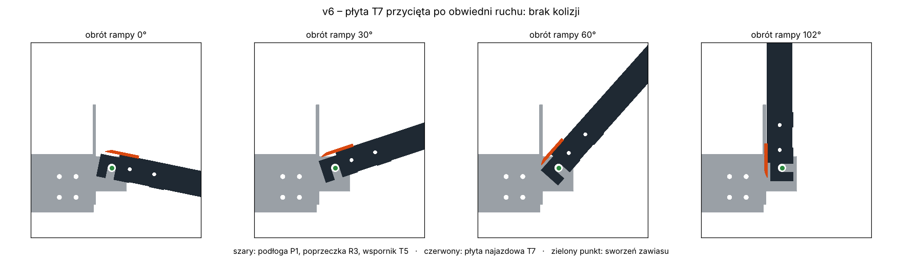
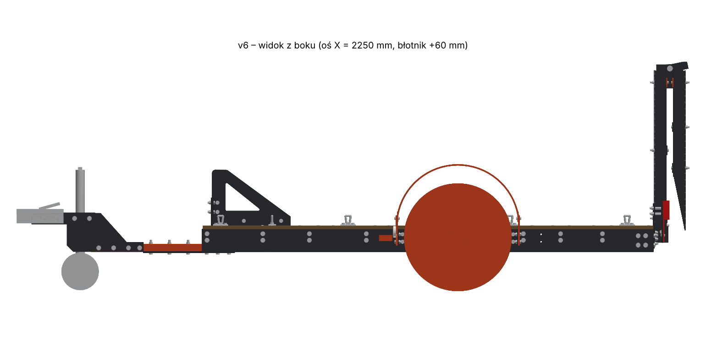
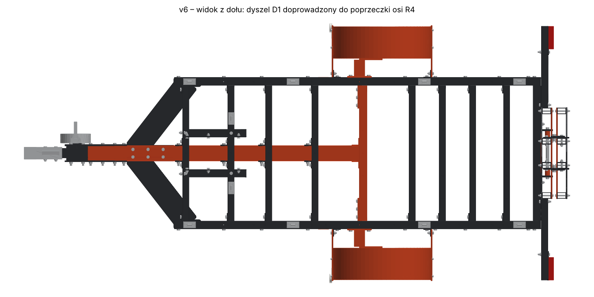
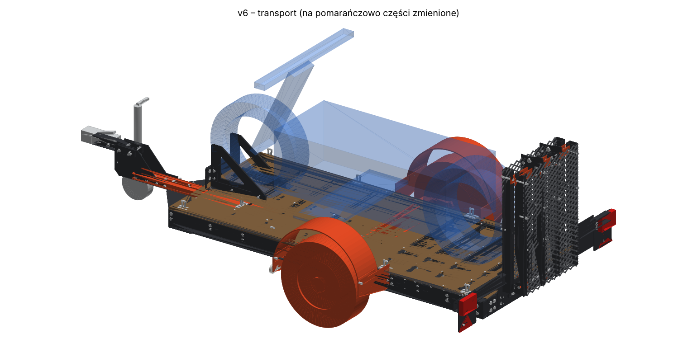
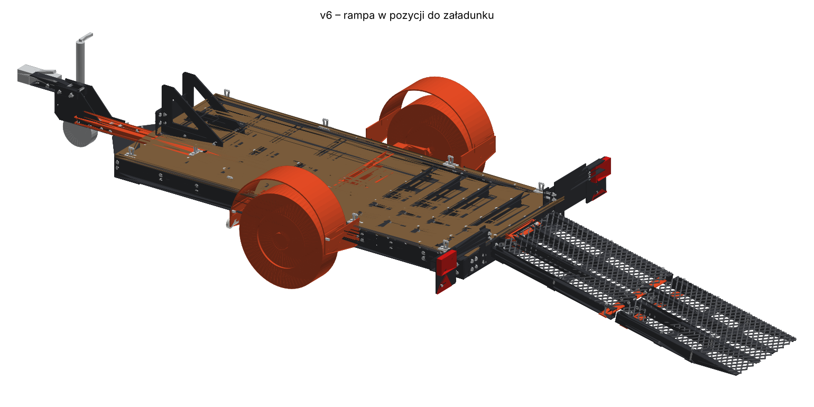

# Przyczepa motocyklowa v5: ocena projektu i poprawki (v6)

Pliki wejściowe: `przyczepa_v5_zlozenie.step` (101 brył spawanych/ciętych, bez nazw),
`przyczepa_v5.glb` (222 części: rama, śruby, części kupne, rampa w dwóch położeniach, obrys motocykla),
`przyczepa_v5.stl` (położenie transportowe, bez motocykla).

Wynik: katalog [`v6/`](v6/). Wszystkie liczby w tym raporcie pochodzą ze skryptów w [`narzedzia/`](narzedzia/)
i da się je odtworzyć (opis na końcu).

---

## 1. Podsumowanie

Projekt jest kompletny i starannie zamodelowany. Rama jest skręcana, ma czytelny podział na części
(R, K, D, N, W, B, S, T), komplet śrub, części kupnych i oświetlenia. Rama sama w sobie **nie ma żadnej kolizji
brył** (sprawdziłem wszystkie pary w STEP). Wymiary i geometria jazdy są rozsądne: wysokość kuli 392 mm,
kąt rampy ok. 11,5°, podłoga na 350 mm, szerokość 1720 mm.

Znalazłem jednak trzy błędy, przez które przyczepa w obecnej postaci **nie zadziała** albo będzie się szybko psuć:

| # | Problem w v5 | Skutek | Status w v6 |
|---|---|---|---|
| 1 | **Rampy nie da się złożyć ani podnieść.** Płyta najazdowa T7 przy obrocie na sworzniu wchodzi w podłogę P1 (18–54°) i poprzeczkę R3 (30–96°). Przy składaniu segmentu 2 szczebel T2#21 zahacza o blachy zawiasu T3, a przekładka T4P leży w tej samej płaszczyźnie co T3 (przenikanie 2,8 cm³ już w spoczynku). W położeniu transportowym blachy T4 przenikają szczebel T2#13. | Oba położenia rampy wyglądają w modelu dobrze, ale nie da się przejść z jednego do drugiego. | ✅ poprawione, symulacja ruchu: 0 kolizji |
| 2 | **Opona prawie dotyka błotnika:** 21 mm luzu nad bieżnikiem (36 mm nad osią koła). | Półosie gumowe uginają się pod ładunkiem i na nierównościach o kilka cm, więc opona będzie trzeć o błotnik. | ✅ błotniki +60 mm, luz 81 mm |
| 3 | **Za duży nacisk na hak:** przy motocyklu 200–300 kg wychodzi 64–93 kg (12–15% DMC). | Haki w autach osobowych dopuszczają zwykle 50–75 kg (sprawdź w dokumentach auta). Przy cięższym motocyklu przekroczysz ten limit. | ✅ oś przesunięta o 150 mm do przodu: 30–64 kg (6–10%) |

Do tego dochodzą rzeczy **konstrukcyjne do decyzji**. Nie są błędami modelu, ale konstrukcja ma w tych miejscach mały zapas:

* **Dyszel D1 100×40×4 leży płasko i kończył się 570 mm przed osią.** Cały nacisk z kuli szedł przez
  cztery poprzeczki 80×40×2 na U-śrubach. W v6 przedłużyłem D1 do poprzeczki osi R4, co obniża naprężenia w R5-1
  ze 112 do 65 MPa. Sam dyszel nadal ma szacunkowo 133–163 MPa (szczegóły w p. 4). **Zalecam obrócić D1 na sztorc
  albo zmienić profil na 80×80×4.**
* **Ścianki 2 mm** w podłużnicach 120×50×2 i poprzeczkach 80×40×2, a połączenia są skręcane przez cienką ściankę:
  rura zgniata się przy dokręcaniu, otwory pracują zmęczeniowo, a profil koroduje od środka.
* **Masa własna ok. 322 kg** jest duża jak na przyczepę na jeden motocykl. Rampa sama waży 46 kg,
  a ma ją podnosić jedna osoba.

---

## 2. Co i jak sprawdziłem

1. **Geometria i profile.** Przekroje policzyłem z brył STEP (OpenCascade), a masy z objętości
   (stal 7850 kg/m³, sklejka 680 kg/m³, części kupne z danych katalogowych).
2. **Kolizje statyczne.** Sprawdziłem wszystkie pary brył STEP (Boolean *common*) oraz wszystkie siatki GLB
   (fcl + manifold).
3. **Kinematykę rampy.** Transformacje „załadunek → transport” odtworzyłem z GLB algorytmem Kabscha.
   Zgadzają się co do 0,00 mm z obrotem 101,67° wokół sworznia KUPNE_pret (3345; 318) i złożeniem 180° na zawiasie
   środkowym (4195,9; 96,7). Następnie obracałem bryły co 6° i sprawdzałem kolizje w każdym położeniu pośrednim.
4. **Luzy koła** (opona–błotnik, opona–wsporniki) oraz położenie odblasków.
5. **Bilans mas, środek ciężkości i nacisk na hak** dla motocykli 150–300 kg. Motocykl stoi kołem w łapie KL,
   jego środek ciężkości przyjąłem w X = 1890–2060 mm. Środek obrysu MOTOCYKL wypada na X = 2175, ale to środek
   prostopadłościanu, a nie prawdziwy środek ciężkości motocykla.
6. **Szacunkowe obliczenia belkowe** dyszla i poprzeczek (p. 4).

## 3. Dane modelu

| Element | Profil / wartość |
|---|---|
| Podłużnice R2 | rura 120×50×2, L = 2425 |
| Poprzeczki R5 (9 szt.) / R3, R4 | 80×40×2 / 120×50×2 |
| Dyszel D1 | 100×40×4 **płasko**, X 280–1830 (v6: do 2100) |
| Rura zaczepu D2 | 60×60×4; kula na X = −75, wysokość 392 mm |
| Blacha trójkątna G1 | 6 mm, usztywnia przód w poziomie |
| Podłoga P1 | sklejka 18 mm, 2420×1000 |
| Rampa | 2 segmenty po ok. 845 mm, szyny 60×40×2, szerokość 600 mm, kąt ok. 11,5° |
| Koła | 155/80 R13 (Ø578), półosie gumowe, rozstaw ok. 1466 mm |
| Wymiary całkowite (transport) | 3613 × 1720 × 1231 mm |
| Masa własna (szac.) | **322 kg**: rama 158, rampa 46, części kupne 68, sklejka 29,5, śruby 20 |

## 4. Wyniki v5 → v6

| Wielkość | v5 | v6 |
|---|---|---|
| Kolizje brył STEP (statyczne) | 8 par (rampa) | **0** |
| Kolizje przy składaniu segmentu 2 | 62 położenia | **0** |
| Kolizje przy podnoszeniu rampy | 19 położeń (T7 w P1/R3) | **0** |
| Luz nad oponą (pion) | 21 mm | **81 mm** |
| Odblask boczny ↔ łby śrub | 0 mm (nachodzi) | 57 mm |
| Oś (środek koła, X) | 2400 | 2250 |
| Nacisk na hak, pusta | 31 kg | 17,6 kg |
| Nacisk na hak, motocykl 150 kg | 52 kg (11,0%) | 30 kg (6,3%) |
| Nacisk na hak, motocykl 200 kg | 64 kg (12,3%) | 40 kg (7,6%) |
| Nacisk na hak, motocykl 250 kg | 76 kg (13,2%) | 49 kg (8,5%) |
| Nacisk na hak, motocykl 300 kg | 93 kg (15,0%) | 64 kg (10,3%) |
| Nacisk na oś, motocykl 300 kg | 529 kg | 558 kg (opony 2×437 kg przy LI 79: OK) |

**Obliczenia szacunkowe** (`wyniki/obliczenia.json`). Przyjąłem współczynnik dynamiczny 2,5, siłę poziomą
D = g·T·R/(T+R) dla auta 1500 kg oraz mimośród 160 mm między kulą a osią D1:

| Miejsce | v5, moto 250 / 300 kg | v6, moto 250 / 300 kg | Uwagi |
|---|---|---|---|
| D1 nad R5-1, profil płaski 100×40×4 | 181 / 215 MPa | 133 / 163 MPa | S235: Re = 235 MPa, za mały zapas na zmęczenie |
| ten sam D1 na sztorc | 101 / 120 | 75 / 91 | ten sam profil, ta sama masa |
| D1 jako 80×80×4 | 87 / 103 | 64 / 78 | |
| Poprzeczka R5-1 (docisk dyszla) | 112 / 134 | 65 / 82 | dodatkowo U-śruby gniotą ściankę 2 mm |
| Rura zaczepu D2 60×60×4 | 27 / 33 | 17 / 23 | OK |

To są obliczenia belkowe na potrzeby decyzji, a nie MES. Przed produkcją dyszel i węzeł N1/D1/G1
trzeba policzyć MES albo sprawdzić próbą zmęczeniową. Orientacyjnie: w badaniach urządzeń sprzęgających wg UN R55 stosuje się siłę zmienną rzędu ±0,6·D przez 2·10⁶ cykli.

## 5. Szczegóły problemów

### 5.1 Rampa: kinematyka (krytyczne)




* **T7 (płyta najazdowa)** wystawała 68 mm przed oś sworznia, nad podłogę. Przy podnoszeniu rampy ten fragment
  schodzi w dół, czyli w podłogę i poprzeczkę R3. W v6 płytę przyciąłem po obwiedni ruchu (z luzem 3 mm),
  więc jej przód jest teraz na X = 3330. Między końcem podłogi a płytą zostaje 30 mm szczeliny i ok. 8 mm progu.
  Koło motocykla przejedzie to bez problemu.
  *Docelowo (v7):* przenieść oś sworznia na wysokość górnej powierzchni podłogi, przy jej krawędzi.
  Dziś oś jest 32 mm niżej i 45 mm za podłogą. Wtedy płyta T7 może leżeć na podłodze bez przycinania.
* **Zawias środkowy.** T3 (segment 1) i T4P (segment 2) leżały w tej samej płaszczyźnie Z 100–106. Przekładkę T4P
  wyciąłem po obwiedni obrotu T3 (0–180°, luz 2 mm). Zostaje z niej fragment 38×57 mm, który nadal spina T1-N-2 z T4.
* **Szczeble T2#13 i T2#21** przy zawiasie środkowym przechodziły przez płaszczyzny blach T3/T4. Podzieliłem je na 3 odcinki
  (szczeliny w Z ±98–114). Śruby i otwory w szynach zostały bez zmian. Pozostałe szczeble wiążą szyny jak dotąd.
* **Wycięcia** pod szczebel T2#11 w blachach T6 (było przenikanie 600 mm³ na blachę).
* **Tuleje dystansowe T8** Ø30/Ø21×43 na sworzniu. W v5 między blachą T6 a wspornikiem T5 było 43 mm wolnego
  sworznia, więc rampa mogła się przesuwać na boki.
* **Siatka segmentu 1** przenikała się z płytą T7 (18 cm³). Przyciąłem ją.

### 5.2 Koło i błotnik



Błotnik leżał 21 mm nad bieżnikiem. W v6 podniosłem błotnik o 60 mm, a wsporniki B1 wydłużyłem o 60 mm w górę
(śruby B1–B2 zostają w starym miejscu). Lampy obrysowe zostały na B1 na tej samej wysokości (288–348 mm).
Wspornik B1 jest 36 mm przed bieżnikiem. Przy ugięciu półosi koło przesuwa się lekko do przodu (wahacz ok. 150 mm),
więc ten luz warto obserwować na prototypie.

### 5.3 Nacisk na hak i położenie osi

Łapa KL ustawia przednie koło motocykla na X ≈ 1190. Środek ciężkości typowego motocykla (rozstaw osi 1400–1600 mm)
wypada wtedy na X ≈ 1900–2050, czyli 350–500 mm przed osią przyczepy. Stąd nacisk 12–15%.
Po przesunięciu osi o 150 mm do przodu nacisk wynosi 6–10% dla motocykli 150–300 kg, a pusta przyczepa
nadal dociska hak (17,6 kg).

Zmiany, które wymusiło przesunięcie osi: poprzeczka R5-5 kolidowała z przesuniętym wspornikiem W6, więc ją usunąłem
razem z narożnikami K1#9/#10 i śrubami W5-5. Jej rolę przejmuje R4. Wkręty podłogi przy R5-5 też usunąłem, a te przy R4 przesunąłem.

Uwaga: nacisk zależy od motocykla. Warto dać w instrukcji tabelkę albo zrobić łapę KL przestawną (2–3 otwory co 50 mm).

### 5.4 Dyszel



W v5 dyszel D1 kończył się na X = 1830, a oś była na 2400. W v6 D1 sięga przedniej ściany R4 (X = 2100),
a dodatkowa para kątowników K2 (kopie K2#4) łączy go z R4. Śruby do tych kątowników trzeba dobrać,
bo w modelu ich nie ma.
**Nie zmieniałem** orientacji ani przekroju D1, bo to pociąga za sobą przeprojektowanie N1, K2, G1 i U-śrub.
To jest pierwsza rzecz do zrobienia w v7.

### 5.5 Pozostałe uwagi

* **Odblaski boczne** (pomarańczowe, obowiązkowe na przyczepach) siedziały na łbach śrub W5-5. Przeniosłem je
  na X 1827–1897, w środkowej tercji długości. Najdalszy z przodu jest ok. 2 m od czoła zaczepu.
* **Pliki:** GLB v5 miał obie pozycje rampy jednocześnie, które się przenikają. W v6 są dwa osobne pliki.
  STEP v5 nie miał nazw części, a STEP v6 ma nazwy (jak w GLB, rampa jako `RAMPA_*`) i kolory.
* **Uproszczenia w modelu, nie błędy:** sklejka, łapa KL i blachy B1/S3 nie mają otworów pod śruby, więc śruby
  „przenikają” te części. Felga przenika oponę i półoś (to uproszczone modele części kupnych). Śruby zacisku kółka
  podporowego wchodzą w uproszczony korpus zacisku.
* **Oświetlenie (orientacyjnie, do sprawdzenia z kartą katalogową lamp):** korpus lamp tylnych zaczyna się na 385 mm,
  a trójkąt odblaskowy na 264 mm, więc wysokości są OK. Dolna krawędź tablicy rejestracyjnej jest na 300 mm,
  czyli dokładnie na granicy minimum. Przy szerokości 1720 mm (> 1600 mm) wymagane są przednie światła pozycyjne
  i są w modelu. Sprawdź, czy lampy obrysowe mają też białe odblaski przednie.
* **Zabezpieczenie rampy w transporcie:** w modelu nic nie trzyma pionowej rampy. Potrzebny jest zatrzask albo
  pas do ucha w ramie.
* **Rozładunek bez auta:** cały motocykl na rampie i z tyłu podłogi jest za osią, więc odłączona przyczepa
  przewróci się do tyłu. Przydadzą się tylne podpory opuszczane przy R3.
* Otwarte końce rur podłużnic (X = 875) wymagają zaślepek, a cała rama otworów odpływowych pod ocynk.

## 6. Lista zmian v6 (wprowadzone w CAD)

Pełna lista generowana przez skrypt jest w [`v6/zmiany_v6.json`](v6/zmiany_v6.json):

1. Oś (półosie, koła, R4, W6, B1/B2, K-POL, obrysówki) przesunięta o **−150 mm** (środek koła X 2400 → 2250).
2. Usunięta poprzeczka R5-5 z narożnikami K1#9/K1#10 i śrubami W5-5. Wkręty podłogi poprawione.
3. Dyszel D1 przedłużony do X = 2100 (do R4). Dodane kątowniki **K2-P#5 / K2-L#5**.
4. Błotniki **+60 mm**, wsporniki B1 wydłużone o 60 mm.
5. Odblaski boczne przeniesione na X = 1827–1897.
6. Rampa: przycięta płyta T7, wycięta przekładka T4P, podzielone szczeble T2#13/T2#21, wycięcia w T6,
   tuleje **T8-P/T8-L**, przycięta siatka segmentu 1.
7. Pliki: osobne GLB dla transportu i załadunku, STEP z nazwami i kolorami, STL w położeniu transportowym.




## 7. Zalecenia na v7 (niewprowadzone, wymagają decyzji)

Kolejność według ważności:

1. **Dyszel:** D1 na sztorc albo 80×80×4 / 100×60×4 i policzenie węzła N1–D1–G1 metodą MES.
   Rozważyć przesunięcie D2 niżej, żeby zmniejszyć mimośród 160 mm.
2. **Ścianki:** podłużnice 120×50×3 (W rośnie z 20,3 do 29,5 cm³, masa +12 kg na obie), a w miejscach śrub tulejki
   dystansowe wspawane w profil. Dotyczy to zwłaszcza mocowania półosi (W6/K-POL) i U-śrub dyszla.
   Poprzeczki R5 można zostawić 80×40×2, jeśli D1 będzie mocniejszy.
3. **Zawias rampy:** oś sworznia na wysokości podłogi przy jej krawędzi, płyta T7 leżąca na podłodze.
4. **Masa (−50 do −60 kg):** rampa aluminiowa albo szyny 50×30×2 i lżejsza siatka (−20 do −25 kg),
   łapa KL z blachy 4–5 mm zamiast 8 mm (−6 kg), sklejka 15 mm lub tylko pas pod koła (−5 do −15 kg),
   przegląd śrub: dziś 20 kg, z czego 18 narożników K1 po 4 śruby.
5. Zatrzask rampy w transporcie, tylne podpory, zaślepki i otwory pod ocynk, przestawna łapa KL.
6. Dobrać części kupne do obciążeń: półosie gumowe ≥ 2×350 kg, opony LI ≥ 79,
   sprzęg na DMC 750 kg i nacisk 75 kg.

## 8. Pliki i odtworzenie

```
przyczepa/
├── RAPORT.md                      ten raport
├── v6/
│   ├── przyczepa_v6_zlozenie.step   102 części z nazwami i kolorami (rama + rampa w położeniu do załadunku)
│   ├── przyczepa_v6_transport.glb   pełny model, rampa złożona, obrys motocykla
│   ├── przyczepa_v6_zaladunek.glb   pełny model, rampa rozłożona
│   ├── przyczepa_v6.stl             położenie transportowe, mm, bez motocykla
│   └── zmiany_v6.json               lista zmian wygenerowana przez skrypt
├── wyniki/                        analiza_v5.json, analiza_v6.json, obliczenia.json
├── obrazy/                        rendery użyte w raporcie
└── narzedzia/                     skrypty (Python, OpenCascade przez cadquery-ocp, trimesh)
```

```bash
pip install -r requirements.txt
python3 narzedzia/popraw_v6.py  v5_zlozenie.step v5.glb v6
python3 narzedzia/analiza.py    v5 v5_zlozenie.step v5.glb wyniki/analiza_v5.json
python3 narzedzia/analiza.py    v6 v6/przyczepa_v6_zlozenie.step v6/przyczepa_v6_transport.glb wyniki/analiza_v6.json
python3 narzedzia/obliczenia.py wyniki/analiza_v5.json wyniki/analiza_v6.json wyniki/obliczenia.json
python3 narzedzia/kolizje_glb.py v6/przyczepa_v6_transport.glb
python3 narzedzia/obrazy.py     v5.glb v6 obrazy
```

Parametry poprawek (przesunięcie osi, podniesienie błotnika, luzy) są na górze `narzedzia/popraw_v6.py`.
